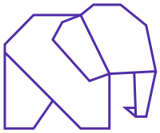

<p align="center">
  
</p>

<p align="center">
  <a href="https://github.com/phel-lang/phel-lang/actions/workflows/tests.yml">
    
  </a>
  <a href="https://github.com/phel-lang/phel-lang/actions/workflows/quality.yml">
    
  </a>
  <a href="https://packagist.org/packages/phel-lang/phel-lang">
    
  </a>
  <a href="https://packagist.org/packages/phel-lang/phel-lang">
    
  </a>
  <a href="https://github.com/phel-lang/phel-lang/blob/main/LICENSE">
    
  </a>
</p>

---

Phel is a Lisp that compiles to PHP. It has macros, persistent data structures and a REPL, and it calls any PHP class or function directly.

## Requirements

PHP 8.5 or newer, on Linux or macOS. CI runs the full test suite on both. Windows gets a smaller suite and best-effort support. The [stability policy](docs/stability.md) says what a version number promises.

## Get started

```sh
composer require phel-lang/phel-lang
```

Open a REPL:

```sh
./vendor/bin/phel repl
```

```clojure
user:1> (->> [1 2 3 4 5] (filter odd?) (map #(* % %)) (reduce +))
35
user:2> (defn greet [who] (str "Hello, " who "!"))
#'user/greet
user:3> (greet "Phel")
"Hello, Phel!"
```

Create a project. `phel init` writes `phel-config.php`, `src/main.phel` and `tests/main_test.phel`; `--minimal` puts the two sources in the project root instead.

```sh
./vendor/bin/phel init
./vendor/bin/phel run src/main.phel   # run a script
./vendor/bin/phel test                # run the tests
./vendor/bin/phel build               # compile to PHP
```

Evaluate code from the command line or from stdin:

```sh
./vendor/bin/phel eval '(+ 1 2)'
echo '(println "hi")' | ./vendor/bin/phel eval -
```

To start from a template, use [`web-skeleton`](https://github.com/phel-lang/web-skeleton) or [`cli-skeleton`](https://github.com/phel-lang/cli-skeleton).

<details>
<summary><b>More examples</b></summary>

**Data pipeline**

```clojure
(def users
  [{:name "Ada" :age 36}
   {:name "Bob" :age 17}
   {:name "Cam" :age 41}])

(->> users
     (filter #(>= (:age %) 18))
     (map :name)
     sort)
;; => ["Ada" "Cam"]
```

**HTTP response**

```clojure
(ns app (:require phel.http :as h))

(def req (h/request-from-globals))

(h/emit-response
  (h/response-from-map
    {:status 200
     :headers {"Content-Type" "text/plain"}
     :body (str "Hello " (:uri req))}))
```

**Macros**

```clojure
(defmacro unless [pred & body]
  `(if (not ~pred)
     (do ~@body)))

(unless (zero? 1)
  (println "not zero"))
;; prints: not zero
```

**PHP interop**

```clojure
(def now (new DateTime))
(.format now "Y-m-d")
;; => "2026-11-13"
```

</details>

## Shell completion

`phel completion` prints a tab-completion script for `bash`, `zsh` or `fish`. It completes commands, options, function names for `doc` and project namespaces for `run` and `test`.

```sh
./vendor/bin/phel completion bash | sudo tee /etc/bash_completion.d/phel   # then restart the shell
./vendor/bin/phel completion zsh > "${fpath[1]}/_phel"
./vendor/bin/phel completion fish > ~/.config/fish/completions/phel.fish
```

The zsh script starts with `#compdef phel`, so it only completes a binary named `phel` on your `$PATH`. If you call `./vendor/bin/phel`, link a global `phel` first. On macOS with Homebrew:

```sh
phel completion zsh > "$(brew --prefix)/share/zsh/site-functions/_phel"
ln -sf "$PWD/vendor/bin/phel" "$(brew --prefix)/bin/phel"
rm -f ~/.zcompdump*   # rebuild the completion cache, then open a new shell
```

## Standalone PHAR

Each [release](https://github.com/phel-lang/phel-lang/releases) attaches `phel.phar`, a single file that runs without Composer. Check it against the sha256 digest GitHub shows for the asset before you run it:

```sh
tag=v1.0.0
gh release download "$tag" --repo phel-lang/phel-lang --pattern phel.phar
expected=$(gh release view "$tag" --repo phel-lang/phel-lang --json assets \
  --jq '.assets[] | select(.name == "phel.phar") | .digest | ltrimstr("sha256:")')
echo "$expected  phel.phar" | shasum -a 256 -c -   # or: sha256sum -c -
```

`phel.phar: OK` means the file matches. On any other output, delete the file. Without `gh`, copy the digest from the release page and compare it with `shasum -a 256 phel.phar`.

Release tags are GPG-signed. In a clone, `git tag -v "$tag"` checks the signature once you import the maintainer's public key.

## Documentation

- [Getting started](https://phel-lang.org/documentation/getting-started/): install, REPL and a first script
- [CLI reference](docs/cli-reference.md): every command and the development loop
- [phel-lang.org](https://phel-lang.org/documentation/): language guide, tutorials and exercises
- [Contributor docs](docs/README.md): architecture and project layout
- [Architecture decisions](docs/adr/README.md)
- [Contributing](.github/CONTRIBUTING.md)

## AI coding agents

`phel agent-install` copies Phel skill files for Claude Code, Cursor, Codex, Gemini, Copilot or Aider into your project. See [resources/agents/](resources/agents/README.md).

```sh
./vendor/bin/phel agent-install claude   # one agent
./vendor/bin/phel agent-install --auto   # agents detected in this project
./vendor/bin/phel agent-install --all    # every supported agent
```
